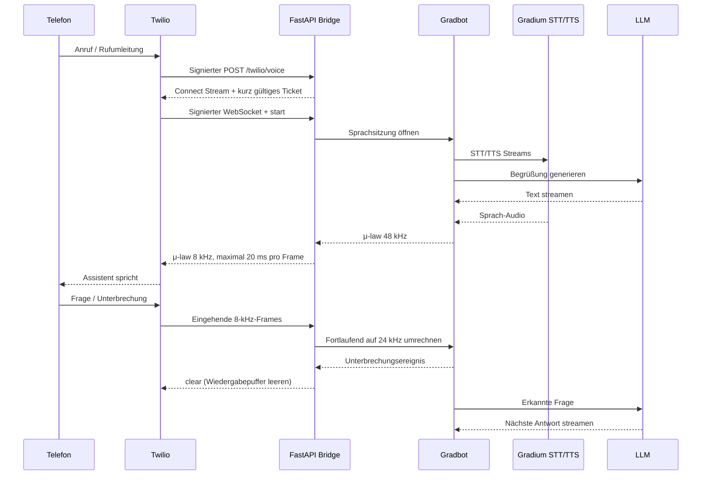

# Architektur

## Module

| Modul | Verantwortung |
| --- | --- |
| `config.py` | Validierte Variablen, Secrets ohne Klartext-repr |
| `security.py` | Kanonische Twilio-Signaturen und HMAC-Stream-Tickets |
| `main.py` | HTTP/TwiML, WebSocket-Authentifizierung, App-Lebenszyklus |
| `bridge.py` | Full Duplex, Kapazität, Fristen und Sitzungs-Cleanup |
| `audio.py` | Zustandserhaltende Abtastratenumwandlung |
| `agent.py` | Prompt und Adapter zur fest versionierten Gradbot-API |
| `cli.py` | Lokal autorisierte Einrichtung, Live-Check, Testanruf |
| `simulation.py` | Offline-Vertragstest mit synthetischen Tönen |

Ein anderer Sprachmotor muss lediglich `AgentFactory`/`AgentSession` implementieren.
Pro Session laufen beide Audiorichtungen gleichzeitig. Ende einer Richtung,
Auflegen, Fehler oder Timeout beendet beide Tasks und schließt das Provider-Handle.
Ein laufendes Gespräch wird nicht automatisch wiederholt. TwiML liefert nach
Stream-Ende eine kurze Fallback-Ansage.

## Latenzbudget

Die lokale Bridge wartet nicht auf vollständige Sprachantworten. Zu trennen sind:
Telefonnetz → Spracherkennung/Turn-Ende → erste LLM-Tokens/TTS-Samples → Wiedergabe.
`call_response_audio` beginnt nach Gradbots Turn-Ende-Ereignis und endet beim
Audio-Versand. `doctor --live` misst Providerstart bis zum ersten Audio. Der
synthetische Netzwerkbenchmark isoliert localhost-Transport samt Codec-Umrechnung.
Keine dieser Metriken allein belegt die wahrgenommene Live-Gesprächslatenz.

Resampler-Zustand bleibt über Frames hinweg erhalten; eine Unterbrechung setzt
nur den Ausgabe-Resampler zurück. Python 3.12 ist bewusst festgelegt, da der
Adapter `audioop` nutzt. Bei einem Python-/Gradbot-Upgrade Codec, Abtastraten und
native Schnittstellen erneut prüfen und gegebenenfalls ersetzen.

## Grenzen und Fehlerverhalten

- Sitzungen: Workerlimit einschließlich noch startender WebSockets. Doppelte
  aktive CallSids werden innerhalb des Workers abgewehrt.
- Startnachricht: fünf Sekunden; Providerstart: Standard 15 Sekunden.
- Erstes Audio und Antwort-Audio nach Turn-Ende: Standard 20 Sekunden. Reine
  Aktivitätsmeldungen ohne Audio verlängern diese Frist nicht.
- Kein Telefon-Audio: Standard 20 Sekunden. Keine Provider-Ereignisse:
  45 Sekunden. Telefonstille kommt normalerweise weiter als Audioframes an.
- Gesamtdauer: Standard fünf Minuten. Limits sind Fehlerschutz, keine
  zugesicherte oder beabsichtigte Antwortzeit.
- Nachrichtengröße, Audioportionen und Uvicorns Netzwerkqueue sind begrenzt;
  Versand wartet höchstens fünf Sekunden. Gradbots interne native Queues liegen
  außerhalb des Adapters; deren Speicherverbrauch unter Last separat beobachten.

Stateless Stream-Tickets gelten 120 Sekunden und sind an die CallSid gebunden.
HTTP- und WS-Replikas können unterschiedlich sein. Globale Einmalverwendung und
globale Kapazitätsreservierung sind nicht implementiert. Für feste gemeinsame
Quoten über mehrere Replikas später verteilte Leases mit TTL ergänzen.

## Produktionsausbau

1. Feste HTTPS-Domain, passende Serverregion, WebSocket-Proxy-Timeout über
   `MAX_CALL_SECONDS`, abgeglichene Providerkontingente.
2. Echte Anrufserien: Begrüßung, fünf Gesprächsrunden, Denkpausen, Unterbrechungen,
   Auflegen und Hintergrundlärm. p50/p95, Fehlerquote, Speicher und Kosten messen.
3. Nach aktiven Gesprächen skalieren, Logs zentral sammeln, vor Scale-down
   Verbindungen auslaufen lassen. Keine nahtlose Übernahme abgebrochener Streams.
4. Persistenz, Human-Handoff und mehrere Nutzer nach Bedarf ergänzen; keine
   synchronen Datenbankzugriffe pro Audioframe.

## Referenzen

- [DigiGrad](https://github.com/gradium-ai/digigrad/tree/f035a575d3847efab3039e8f3daa85cf10380704)
  als Referenz für Twilio/Gradbot. Dieses Projekt ist eine eigene reduzierte
  Implementierung, kein vollständiger Fork.
- [Gradbot Python](https://github.com/gradium-ai/gradbot/tree/db64d7703b478f85476adab8bb8c9a8db617dbf0/gradbot_py)
  und installierte Typdefinitionen von `gradbot==0.1.9`: API-Vertrag und Abtastraten.
- [Twilio Media Streams](https://www.twilio.com/docs/voice/media-streams/websocket-messages):
  `start`, `media`, `stop`, `clear`.
- [Twilio Stream](https://www.twilio.com/docs/voice/twiml/stream):
  `Connect/Stream` und benutzerdefinierte Parameter.
